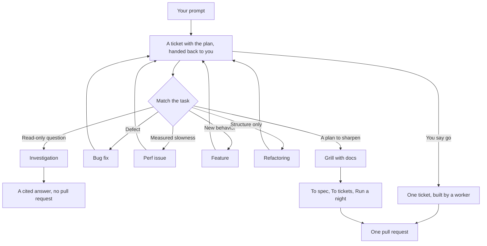

# Route work through `mmw-mode`

[`mmw-mode`](../../skills/mmw-mode/SKILL.md) is the one entry to MMW v4. You give a session a goal. The session matches it to a playbook, works through that playbook's steps, and runs the other skills as the steps name them. In this chapter you learn how a session enters `mmw-mode`, how it picks a playbook, and what a good prompt carries.

## Every session reads it first

You do not type a command to turn `mmw-mode` on. Its `description` tells every session to read it in full at the start, before anything else. A host reads skill descriptions when the session starts, so the session reads `mmw-mode` before it acts on your first message.

Most of the other skills carry the description "Run only when the user, mmw-mode or another skill names it". They do not start on their own. `mmw-mode` and its playbooks name them at the step that needs them, and you can name one yourself in a prompt.

The skill is read in two layers. Its `SKILL.md` is what every agent judges with, the session you talk to and every agent it sends. Its [`references/handling-a-request.md`](../../skills/mmw-mode/references/handling-a-request.md) is read only by a session holding a request, the one you opened, because its first message names no file to follow. A session holding an assignment, one that `dispatch.sh` or a subagent call started with a file to follow, works by that file. Between them they hold seven sections. These five shape what you see:

- **Non-negotiables.** Triggers. Those for an agent's own work are in `SKILL.md`: any prose runs `unslop`, any `.ts` file runs `typescript-best-practices`. Those for the task as a whole are in `handling-a-request.md`: a nontrivial change runs `how` first, and a contested design gets `code-review`.
- **Principles.** An index of the 30 principle skills, each with when it applies, in `SKILL.md`. The reply names each principle that changed a decision. [Shared principles and automatic loading](./08-principles.md) covers them.
- **Autonomy.** What an agent does without asking, and what it always pauses for: irreversible writes such as a force-push, a deploy, a data deletion or a customer message.
- **Writing the reply.** How the report to the owner reads: effects and reasons, not code, with evidence the owner can check. It is in `handling-a-request.md`.
- **Playbooks.** The list that routes a task to one playbook file, in `handling-a-request.md`.

## How a task becomes a playbook



The session works through the matched playbook's steps.

The diagram shows the common routes. The `## Playbooks` section of `mmw-mode`'s `references/handling-a-request.md` lists them all, and the [playbook directory](../../skills/mmw-mode/playbooks/) holds the files. Beyond the diagram there are playbooks for:

- Planning. Chart the map, Work through the map, To spec, Revising a spec and To tickets.
- Measurement and diagnosis. Hillclimb, Runtime forensics and Trace forensics.
- Interfaces. Prototype, which is the `prototype` skill.
- The skill set itself. Authoring or modifying a skill, and Eval.
- The session itself. Session pickup, Pause safely, and Worktree and simulator cleanup.

A session that the `dispatch` skill started matches nothing: its start prompt tells it to read `mmw-mode`, names the file it works by, and says that file is its whole task. Because a file is named, it reads only `SKILL.md`, so it neither picks a playbook, nor redoes what its sender did, nor sends anyone that file does not name. It works a ticket, reviews one, answers a research brief, designs one candidate, or gives a second opinion. You do not prompt those sessions.

Every playbook that changes the repository ends the same way. Its first step opens a ticket and a `fix-<n>` branch, and its last step hands the ticket, with the plan written in, back to you. Nothing is built until you say go; then [One ticket](../../skills/mmw-mode/playbooks/one-ticket.md) sends a worker, checks what it built, and opens the pull request.

One rule overrides the matching. A ticket with acceptance criteria is worked only by a worker that `dispatch` sends. Give a session such a ticket of your own and it runs One ticket on it: it cuts a `fix-<n>` branch, sends a worker, and tells you.

## Say the goal, not the ceremony

You do not write a spec. Say what is wrong or what you want, plus anything you already know that saves the agent time:

```text
users get two notifications after a retry. repro first, then fix and verify.
```

That is a Bug fix prompt. "repro first" is a real constraint, and the playbook keeps it. The session opens a ticket, reproduces the defect, finds the cause, and writes into the ticket the cause and, as its first criterion, a regression test that must fail on the project branch. It hands the ticket back to you. On your go, a worker writes the fix, and the session runs the original reproduction again before it opens the pull request.

## What goes in a prompt

A useful prompt carries up to five things, and each fits in a sentence:

- **The goal.** Say what is wrong, or what you want.
- **The done check.** It must be able to pass or fail. "Make it better" and "work on it for an hour" are not checks.
- **The proof you want to see.** Ask for the real command output, a recording of the flow, the stored value, or a before-and-after number.
- **What you already know.** A symptom, a repro step, a log line or a link saves the agent a search.
- **The real constraints.** "repro first", "don't change any code yet", "zero behavior change" and "let me review before proceeding" each change what the agent does.

Here is one prompt with all five:

```text
the csv export drops its last row since yesterday's deploy. failing job id is 4812. repro first, then fix. done means the 60k-row fixture exports every row. show me the row counts before and after.
```

Leave two things out:

- **The how.** Say what to achieve, and leave the agent room to find a better path than the one you would pick. The same goes for a list of skills, covered in the pitfall at the end.
- **Your theory of the cause, at first.** A stated guess narrows the search to where you pointed. Let the agent restate the problem before you share your hunch.

For a noisy report, such as a long thread or a vague bug, make the restatement the first step:

```text
read this thread. restate the underlying issue in your own words, in plain english. don't change any code yet.
```

A misreading shows up in the restatement, before any code exists. Correcting it there costs you one message instead of one wrong fix.

## Ask a question when you mean a question

`mmw-mode` treats two kinds of message in opposite ways. In a discussion, "could we change X to Y?" asks for an answer, not for the change. The session answers and waits for you to say go. When it cannot tell which you meant, it treats the message as a question.

An approved plan or ticket is the go signal. The session runs it to the end and stops only for a decision that is yours: what the customer sees, what happens to money, what is in scope and in what order, what goes out to the public, and what cannot easily be undone. It does not end a turn with "shall I continue?".

Asked for an opinion, the session gives its real judgment, including "no". When you push back, it rechecks the evidence and reports what it finds, whichever way that goes.

## Follow up short

When the conversation already carries the context, the prompt shrinks to almost nothing. Each of these is enough:

```text
do it
```

```text
continue
```

```text
keep going until done
```

Short works because the session read `mmw-mode` at its start and the playbook holds the structure. Your words carry the intent, and the playbook carries the steps.

## Switch tasks with "new task"

A long session accumulates context from the last task. When you change subjects, say so:

```text
new task. figure out why the cache entry survives logout. don't change any code yet.
```

"new task" tells the session to match a playbook again instead of continuing the last one. "don't change any code yet" pins this task to Investigation. Without those two phrases, a session in the middle of a Feature tends to treat your question as the next feature step.

## Give parallel work its own worktree

Several agents in one repository on one computer fight over the working tree, the ports and the build output. Give each task its own branch and git worktree:

```text
new task. branch off <base> in a fresh worktree, then port the parser change there.
```

The pipeline already does this for tickets. Each ticket gets its own `issue-<n>` worktree under the repository's `.worktrees/`. Worktrees cost disk, so a laptop runs only a handful at once. When disk gets tight, ask:

```text
what's eating my disk? prune the worktrees that are safe to prune.
```

The [Worktree and simulator cleanup](../../skills/mmw-mode/playbooks/worktree-cleanup.md) playbook sorts every worktree by merge state, uncommitted work and which sessions still touch it. It deletes only what that evidence clears, and pauses for your call on anything that holds uncommitted work.

## Leave it running

"going to bed", "don't stop" and "run until done" tell the session to keep going without you. Say what done means:

```text
im stepping away. keep going until the migration check reports zero old callers.
```

A batch of overnight work goes through Run a night. The tickets' events and the night summary record what happened. To spec records the decisions, To tickets cuts the tickets, and Run a night has workers build them unattended into one pull request. [Run work while you sleep](./07-overnight.md) covers it.

To stop a session cleanly, ask it to pause. The [Pause safely](../../skills/mmw-mode/playbooks/pause-safely.md) playbook commits the work in progress and writes a resume note. A later session resumes from it with [Session pickup](../../skills/mmw-mode/playbooks/session-pickup.md).

**Pitfall.** Do not list skills in your prompt ("use how, then prototype, then arena..."). The playbook already orders them, and a hand-written order usually reorders or drops steps the playbook would have kept. Name a skill only when you want to override a specific choice.

Read [`handling-a-request.md`](../../skills/mmw-mode/references/handling-a-request.md) itself for the full routing rules.

Next: [Understand the code](./03-understand.md).
