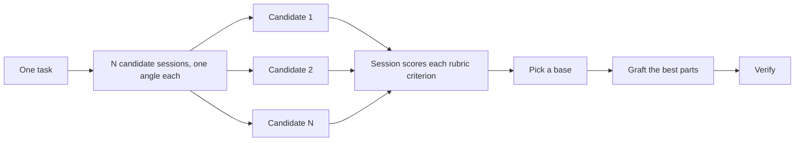

# Design before you write code

One attempt at a hard design locks in the first shape the model thought of. The [prototype skill's sketch branch](../../skills/prototype/SKETCH.md) settles types and seams before implementation when the shape reaches beyond one ticket. The [arena skill](../../skills/arena/SKILL.md) runs several attempts at the same brief and merges the best parts. The [prototype skill](../../skills/prototype/SKILL.md) answers an open question by running something. The [code-review skill](../../skills/code-review/SKILL.md) reads a finished change with eyes that did not write it.

The two most common design mistakes are taking the agent's first design and debating a question that a prototype could settle. This page fixes both. The written plan comes after: a spec and its tickets, which you can check and accept before agents build from them.

## Settle code shape with the prototype skill's sketch branch

```text
use the prototype skill to settle the import pipeline shape before writing any code. i care most about how callers use it.
```

The sketch branch works in three phases. First it grounds itself. It runs the how skill over the code the design touches, adds the why skill when the design moves ownership or layers, and looks for what already solves the problem (**principle-start-from-what-exists**), taking what its caller already found rather than doing it again. A shape later work builds on (an interface code outside the change calls, a data shape stored or passed between subsystems, a change across subsystems) goes to the arena skill with at least two structurally different candidates. Each candidate gets one constraint:

- Minimize the interface, with one to three entry points.
- Maximize flexibility for many uses.
- Make the most common caller's case trivial.
- Design around ports and adapters, when dependencies cross a seam.

Every candidate is screened against [`references/design-red-flags.md`](../../skills/prototype/references/design-red-flags.md) and scored on depth, locality, and seam placement, in the [codebase-design skill](../../skills/codebase-design/SKILL.md)'s terms. Last, it hands back one synthesized sketch: the caller's usage written first, then types and signatures whose bodies say `not implemented`, with a rationale shaped by [`references/rationale-template.md`](../../skills/prototype/references/rationale-template.md). It writes no implementation.

You rarely need to type it. The build playbooks send code-shape questions to the prototype skill's `## Pick a branch`. It draws a sketch only when the shape reaches beyond one ticket and no prototype, ADR, or earlier spec has settled it. Inside one ticket, the worker shapes the code from the data shape named in the ticket, and the reviewer judges it.

The sketch is not sacred once code starts. If implementation needs the same workaround in unrelated places, or types that compile only with forced casts, [`principle-redesign-from-first-principles`](../../skills/principle-redesign-from-first-principles/SKILL.md) treats that as proof the sketch is wrong. A worker raises a `contract` child rather than scrapping a baseline sketch. The coordinator re-runs the prototype skill's sketch branch and resumes the worker with the corrected baseline.

For a second opinion on a design before it is committed, the session sends an `advisor`, as the `## Subagents` section of the `mmw-mode` skill's `references/handling-a-request.md` says. The [advisor skill](../../skills/advisor/SKILL.md) judges a decision already framed and changes nothing.

## Fan out attempts with the arena skill

```text
/arena design the cache key format from four angles. it is expensive to change later.
```

The arena skill is the sole sender of candidates for both the sketch and UI branches, and for direct design requests. It gives the same task to N candidates, one per angle, and each candidate writes only its own `candidates/<n>/` directory. Each candidate is a `candidate` session sent with `dispatch.sh send candidate --follow "the arena skill's references/candidate.md"`. The brief names artifact-specific rules under `## Task`, and the shared grounding and output directory under `## Known`. A UI brief also gives the URL that opens its variant. All candidates run on the one host and model that `~/.mmw/models.json` gives that role, so their differences come from their angles, not from their models. The ranking rubric stays out of every brief; each candidate receives the completion criterion it must meet.

After every candidate reports, the session reads every candidate end to end, scores each against the rubric criterion by criterion, and writes down the scores. It picks a base, grafts the best one or two ideas from the others into the base, and verifies the result. A short synthesis note records the base, each graft and its source, each rejection and why, and any dropout. The caller decides who picks the base and whether to keep `candidates/`. For UI, the owner chooses the base, and the variants stay.



When the candidates converge on one shape, that agreement is the result and no graft is needed. When they diverge wildly, the task was framed too loosely. The arena skill reframes and runs again rather than averaging.

## Review a change with the code-review skill

```text
review the changes on this branch. the request was: add a --json flag, text output stays byte-identical.
```

The code-review skill reads a finished change on four axes, each a separate subagent on the `review-axis` subagent row, whose model and effort per host you set with `models.py config subagent` (`inherit`, the default, keeps the session's own):

- Standards asks whether the code follows the conventions the repository documents, and whether less code would do the same.
- Spec asks whether the code does what was asked, no less and no more.
- Tests asks whether the tests the acceptance criteria name could ever fail.
- Correctness asks whether the code works on every input and state it can meet, at the root cause, without opening a security hole.

The axes never see each other's findings, so a change that passes one axis cannot cover for a failure on another. The session then checks every finding at the cited line. A finding either holds, is refuted with the evidence that disproves it, or is marked as one it could not settle. Refuted findings are listed with their refutation, not dropped.

A ticket's worker sends a `reviewer` session to its diff. The `mmw-mode` skill also routes "review this change" to it. Asked to review a pull request someone else opened, the session runs the four axes with the pull request's description in a file in place of a ticket.

Spend a review on code, not on an abstract plan. Point a reviewer at a plan with no code behind it and it invents risks that will never happen. Let prototypes settle the questions, then review what got built.

## Prototype instead of debating

Never take the first design. Ask for a few, and pick from evidence you can see:

```text
prototype a few options for the new dropdown menu. take screenshots for me to compare.
```

The prototype skill builds code that answers one question, and the question decides its shape:

- A logic question gets one HTML file that a non-developer can click through.
- A UI question gets several variants on one route, switched by a URL parameter.
- An implementation question gets the smallest runnable experiment, and records what it shows.
- A question about the shape of the code goes through the sketch gate in `## Pick a branch`.

Each prototype lives in a leaf directory `efforts/<effort>/prototypes/<issue>/<UI|LOGIC|EXP|SKETCH>/`, with its conclusion in the feature file for UI, or a verdict comment on the asking ticket for LOGIC, EXP and SKETCH that states the question, the verdict with its exact names and values, and what was ruled out. That verdict outlives the session. A spec cites it, a ticket copies its values, and a worker builds from it at night with no one to ask.

Prototypes also stop the agent asking you questions it can answer itself. The `mmw-mode` skill's Non-negotiables say that a fork whose answer you could observe by running something is not yours to answer. The session sketches it with the prototype skill and lets the result decide. You are asked only the calls that are yours: what the user sees, what happens to money, and what is in scope.

## Design in the running product

For a new or changed UI, the [prototype skill's UI branch](../../skills/prototype/UI.md) builds a complete, interactive local prototype in the product's own code. Existing interfaces and login use the real local backend; an API fake supplies missing interfaces from the environment tool's test seed data. The prototype runs at the final routes with an environment variable, so you try the design in the product itself.

Before variants are generated, the session mounts their reserved `?variant=` keys with placeholders and adds the switcher. Candidates can then open their own variants. When the direction is open, try structurally different variants through the switcher and choose the winner or a combination. The session keeps the other variants. Once you choose a direction, you and the session iterate one question at a time, changing it in place and committing each round. You operate the page yourself. The session checks every button's API call and settles questions that affect the UI with you during iteration.

Before approval, the session checks that the prototype demonstrates every visible rule in the settled decisions. It writes the feature description from the winner, those decisions and the glossary. You say "就是这个" in the running page. That is design freeze, the only design approval; you do not approve the description sentence by sentence. For its recorded development scope it is also the go-ahead, unless the ticket adds scope beyond the prototype and recorded decisions.

The winner lives under `efforts/<effort>/prototypes/<issue>/UI/winner/` on the effort branch or `fix-<n>`. Its conclusion goes in the feature file, not a prototype README. The mount points stay until implementation. Workers copy the winner's appearance and interactions while rewriting code to production standards and building the real backend. The same test steps and assertions run on prototype and product. Spec review compares screenshot pairs, and the pull request shows you prototype and product screenshots side by side in the same states.

## Write the README first for shared code

For a package or API that other code will use, start with the document a user would read:

```text
write a tutorial for how i would use the new config package first. then /teach me why it beats the current one.
```

Writing the tutorial first forces the caller's view. The document also becomes a concrete target the agent checks its own work against. Name the [technical-writing skill](../../skills/technical-writing/SKILL.md) when the document itself matters, so a tutorial stays a tutorial.

## Plan after the design settles

A spec and its tickets are what you can check and accept before agents build from them unattended. Planning runs in three stages.

**Settle the decisions.** For a plan that fits one session, use [Grill with docs](../../skills/mmw-mode/playbooks/grill-with-docs.md):

```text
grill me on the export redesign. write the glossary and ADRs as we go.
```

It interviews you with the [grilling skill](../../skills/grilling/SKILL.md) and the [domain-modeling skill](../../skills/domain-modeling/SKILL.md). It writes each settled term into the glossary as it settles, and offers an ADR for each decision that is hard to reverse. Each open question goes to whoever owns it. You get what the user sees, money, and scope. A fact goes to a `researcher` session. An answer that running something would show goes to the prototype skill. When the plan turns out too big for one session, it proposes switching to a map, and you decide.

For an idea too big for one session, with the way to the end not yet visible, use a wayfinder map. [Chart the map](../../skills/wayfinder/references/chart-the-map.md) names the destination with you, then creates one GitHub issue as the map, labelled `wayfinder:map` and `mmw:map`, with decision tickets as its child issues. It sends a `researcher` for each research ticket and resolves nothing else by hand. [Work through the map](../../skills/wayfinder/references/work-through-the-map.md) then resolves one decision ticket per session, records the answer on the map, and stops when no ticket is open and nothing is left unspecified. The map format is in [`wayfinder/SKILL.md`](../../skills/wayfinder/SKILL.md).

**Record them in a spec.** Once the decisions are settled, ask for the spec:

```text
turn what we decided into a spec. the migrated ui must match the original exactly, bugs included.
```

The [to-spec skill](../../skills/to-spec/SKILL.md) records decisions and makes none of yours. It interviews nobody for facts. An engineering call the sources leave open, such as a data shape or the seam where a test observes the result, it makes and marks "this spec's decision". A call on what the user sees, money, or scope that no source settles, it puts to you before it publishes. A code shape the spec would rest on that nobody settled sends it back to the discussion instead. The spec is published as a GitHub issue labelled `mmw:spec`. "bugs included" in the request keeps a migration from fixing things on the way, which would make the old and new output impossible to compare. To change a published spec, use [the revise entry](../../skills/to-spec/references/revise.md), which edits it in place.

**Cut the tickets.** Develop a change uses [to-tickets](../../skills/to-tickets/SKILL.md) when a batch is needed. A spec-only request stops after publication. The batch entry cuts the spec into vertical slices, each one complete through every layer, and gives each ticket the tickets that block it. Every acceptance criterion is a command and its expected output, so "it passed" is a fact a machine decided. A judgment goes to review, a person's reaction becomes a ticket for a person, and a preference is a choice put to you. It lints the drafts, quizzes you on them, and publishes them as sub-issues of the spec only after you approve.

The published tickets then run as a night. [Run work while you sleep](./07-overnight.md) covers that.

## Match the design work to the task

Most changes need none of this. A rough ladder:

- A small finished change you are unsure about needs the code-review skill alone.
- A code shape that reaches beyond one ticket earns the prototype skill's sketch branch, which brings the arena skill with it.
- A standalone decision where independent attempts help, such as naming, a format, or an algorithm, goes to the arena skill directly.
- An open question you could answer by running something, such as a layout, a timing, or an approach, gets a prototype, not a debate.
- A code change enters Develop a change; it reuses existing decisions and only calls discussion, spec or decomposition methods when missing. A small change stays an independent ticket.

The `mmw-mode` skill already applies this ladder. Name these skills yourself when you want more or less scrutiny than its default.

Next: [Build and clean the change](./05-build-and-clean.md).
