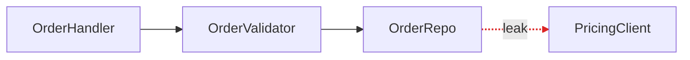

# HTML Report Format

An architecture review's report is a single self-contained HTML file in the OS temp directory. For call graphs, dependencies and sequences, render Mermaid to inline SVG before delivery, or draw the graph directly in SVG. Hand-built divs and inline SVG handle the more editorial visuals (mass diagrams, cross-sections).

## Scaffold

```html
<!doctype html>
<html lang="en">
  <head>
    <meta charset="utf-8" />
    <meta name="viewport" content="width=device-width, initial-scale=1" />
    <title>Architecture review for {{repo name}}</title>
    <style>
      body { margin: 0; color: #0f172a; background: #fafaf9; font-family: system-ui, sans-serif; }
      main { max-width: 64rem; margin: auto; padding: 3rem 1.5rem; }
      #opportunities { display: grid; gap: 2.5rem; }
      .comparison { display: grid; grid-template-columns: repeat(auto-fit, minmax(min(100%, 19rem), 1fr)); gap: 1rem; }
      svg { display: block; width: 100%; height: auto; }
      .seam { stroke-dasharray: 4 4; }
      .leak { stroke: #dc2626; }
      .deep { background: linear-gradient(135deg, #0f172a, #1e293b); }
    </style>
  </head>
  <body>
    <main>
      <header>...</header>
      <section id="opportunities">...</section>
    </main>
  </body>
</html>
```

## Header

Repo name and date. No introduction paragraph. Straight into the opportunities.

## Opportunity card

The diagrams carry the weight. Prose is plain and uses the glossary terms (from [codebase-dic](../../../codebase-dic/SKILL.md)) without ceremony.

Each deepening opportunity is one `<article>`:

- **Title**: names the deepening (e.g. "Collapse the Order intake pipeline").
- **Badge row**: recommendation strength (`Strong` = emerald, `Worth exploring` = amber, `Speculative` = slate), plus a tag for the dependency category (`in-process`, `local-substitutable`, `ports & adapters`, `mock`). The opportunity you'd tackle first also gets a `Recommended first` badge with its reason beside it.
- **Files**: monospaced list in a small font.
- **Before / After diagram**: the centrepiece. Two columns, side by side, with a legend beside it for the marks it uses: solid box = module, dashed line = seam, red arrow = leakage, thick dark box = deep module. See patterns below.
- **Problem**: what hurts.
- **Solution**: what changes.
- **Benefits**: bullets. e.g. "Tests hit one interface", "Pricing logic stops leaking", "Delete 4 shallow wrappers".
- **ADR callout** (if applicable): in an amber-tinted box.

## Diagram patterns

Pick the pattern that fits the opportunity. Mix them. Don't make every diagram look the same. Variety is part of the point.

### Mermaid graph (the workhorse for dependencies / call flow)

Use a Mermaid `flowchart` or `graph` when the point is "X calls Y calls Z, and look at the mess." Colour leakage edges red and the deep module dark. Sequence diagrams work well for "before: 6 round-trips; after: 1." The example is Mermaid source. Embed its rendered SVG in the report.



### Hand-built boxes-and-arrows (when Mermaid's layout fights you)

Modules as `<div>`s with borders and labels. Arrows as inline SVG `<line>` or `<path>` elements positioned absolutely over a relative container. Reach for this when you want the "after" diagram to feel like one thick-bordered deep module with greyed-out internals, since Mermaid won't render that with the right weight.

### Cross-section (good for layered shallowness)

Stack horizontal bands with a thick left border to show layers a call passes through. Before: 6 thin layers each doing nothing. After: 1 thick band labelled with the consolidated responsibility.

### Mass diagram (good for "interface as wide as implementation")

Two rectangles per module: one for interface surface area, one for implementation. Before: interface rectangle is nearly as tall as the implementation rectangle (shallow). After: interface rectangle is short, implementation rectangle is tall (deep).

### Call-graph collapse

Before: a tree of function calls rendered as nested boxes. After: the same tree collapsed into one box, with the now-internal calls shown faded inside it.

## Style guidance

- Lean editorial, not corporate-dashboard. Generous whitespace. Serif optional for headings (serif works well with stone/slate).
- Colour sparingly: one accent (emerald or indigo) plus red for leakage and amber for warnings.
- Keep diagrams ~320px tall so before/after sits comfortably side by side without scrolling.
- Use small uppercase type with wide letter spacing for module labels inside diagrams, so they read as schematic, not as UI.
- Keep the report static. The diagrams should be visible when the file opens offline.

## Tone

Use plain English. The architectural nouns and verbs come straight from [codebase-dic](../../../codebase-dic/SKILL.md). Define each of those terms in the legend beside each diagram that uses it. Elsewhere the plain-language rule of [big-pics-little-words](../../../big-pics-little-words/SKILL.md) applies.

**Use exactly:** module, interface, implementation, depth, deep, shallow, seam, adapter, leverage, locality.

**Never substitute:** component, service, unit (for module) · API, signature (for interface) · boundary (for seam) · layer, wrapper (for module, when you mean module).

**Phrasings that fit the style:**

- "Order intake module is shallow: interface nearly matches the implementation."
- "Pricing leaks across the seam."
- "Deepen: one interface, one place to test."
- "Two adapters justify the seam: HTTP in prod, in-memory in tests."

**Benefits bullets** name the gain in glossary terms: *"locality: bugs concentrate in one module"*, *"leverage: one interface, N call sites"*, *"interface shrinks; implementation absorbs the wrappers"*. Don't write *"easier to maintain"* or *"cleaner code"*, because those terms aren't in the glossary and don't earn their place.

No hedging, no throat-clearing, no "it's worth noting that…". If a sentence could be a bullet, make it a bullet. If a bullet could be cut, cut it. If a term isn't in the [codebase-dic](../../../codebase-dic/SKILL.md) glossary, reach for one that is before inventing a new one.
